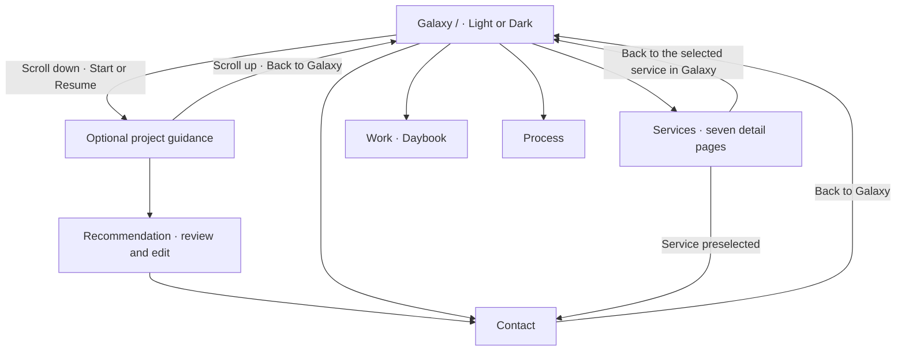

# Galaxy navigation and project guidance implementation plan

November 13, 2026. Status: shared navigation, reversible scroll and the hybrid answer panel are implemented in the local preview. See the implementation record below.

The current site uses Galaxy in both themes. Starworld is retired from site navigation, and its old address opens Galaxy. The quiz remains paused in the visitor flow.

Start from the [site audit](../reviews/website-design-mapping-audit-2026-11-13.md), the [website design reference](../research/website-design-research.md), the [website mapping reference](../research/website-mapping-research.md) and the [quiz research](../reviews/galaxy-quiz-user-research-2026-11-13.md).

## Outcome

Galaxy is the homepage at `/` in both palettes. The shared menu is **Galaxy · Services · Work · Process · Contact**. Services leads to the same seven detail pages as the scene. Work contains Daybook. A visitor can open a service or Contact directly. A visitor who wants help deciding can continue from Galaxy to project guidance and return upward to Galaxy with their work intact.

Use existing HTML, CSS, JavaScript modules, Three.js and the static build. Keep the existing service model IDs, Core animation, service URLs and strict HTTPS inquiry flow. The navigation work and the study of the quiz can proceed independently until the question interface needs a product decision.

## Premortem

Assume the release failed. Probability and impact are planning estimates. Each row has a release check and a prevention decision built into the blocks below.

| Failure                                                                                | Probability | Impact | How to detect it                                                                                                                                                             | Prevention and release check                                                                                                                                                                                      |
| -------------------------------------------------------------------------------------- | ----------- | ------ | ---------------------------------------------------------------------------------------------------------------------------------------------------------------------------- | ----------------------------------------------------------------------------------------------------------------------------------------------------------------------------------------------------------------- |
| Scroll momentum launches twice, traps scrolling, or activates a sphere                 | High        | High   | Use native wheel and touch from canvas, controls and nearby content. Reverse before, during and after the boundary. Inspect scroll position, mode, answer count and history. | Keep one stable document boundary, passive observation and one transition per crossing. Scope drag capture to explicit Rotate mode. Block 3.                                                                      |
| The sticky stage moves the boundary as the quiz HUD opens                              | High        | High   | Compare marker and canvas bounds in both modes at 320 and 390 px, landscape, enlarged text and real Safari. Scroll quickly past the entire stage and back.                   | Give the story a stable flow extent. Separate viewport geometry from visual mode and use an unpinned layout where the stage and controls cannot fit. Block 3.                                                     |
| A question or sphere label becomes ambiguous or clipped                                | High        | High   | On phones, read and operate every choice, compare label and service identity, and record mistaken or repeated taps. Check keyboard and 200% text.                            | Use one labeled HTML choice group in normal flow, preserve explicit confirmation, keep passive holograms secondary, and validate against the same question IDs. Block 5.                                          |
| Theme, exit or page return discards answers, or an old quiz overwrites a current draft | High        | High   | Answer one question, reverse scroll, switch palette, open a service, refresh and return. Test stored, invalid, blocked and stale data.                                       | Separate scene view from the questionnaire. Use in-place theme changes and bounded same-tab storage for allowed answers. Scope the summary handoff to an explicit action and protect newer edits. Blocks 2 and 4. |
| Failed JavaScript or WebGL leaves visible actions inert                                | High        | High   | Block the scene entry and a transitive import separately. Disable JavaScript and simulate GPU loss and restoration. Activate every visible primary control.                  | Serve native navigation and a readable project-help route in HTML. Keep lightweight controls and questionnaire independent of the renderer. Blocks 1 and 5.                                                       |
| Legacy links, canonical URL, or protected hosting break                                | Medium      | High   | Open `/home/`, `/explore.html`, Daybook shares, service deep links and fragments against local and packaged HTTPS. Compare canonical, sitemap and return targets.            | Migrate route generation and metadata together. Retain aliases and preserve meaningful query and fragment context. Check the strict deployment’s CSP and allowlisted paths. Blocks 1 and 2.                       |
| Header, keyboard focus or Contact controls disappear under overlays                    | High        | High   | Check hit points, text bounds, 200% text, focus after Escape, and the on-screen keyboard.                                                                                    | Let the header reflow, restore focus on explicit dismissal and use the actual sticky-header offset. Make Contact’s current action an in-page jump. Blocks 1 and 4.                                                |
| Research mistakes novelty or quiz completion for better guidance                       | Medium      | High   | Compare direct navigation, a text questionnaire and a hybrid on equivalent tasks. Ask users to explain the recommendation and choose their next action.                      | Use predeclared task outcomes and intent groups. Evaluate the answer layout independently of question and scoring changes. Blocks 0 and 5.                                                                        |
| Local QA overstates mobile smoothness or secure delivery                               | Medium      | High   | Record browser, device, input and environment. Repeat graphics and scroll checks on hardware and submit synthetic data in staged HTTPS.                                      | Keep lab, handset, visitor and intake evidence distinct. Mark unavailable device or staged tests as deferred. Block 6.                                                                                            |

## Blocks and dependencies

### 0. Baseline and research — start in parallel

- Record current routes, gesture behavior, layout and focused browser assertions from the audit. Use the existing Chromium preview and screenshots as regression evidence.
- Study the visitor’s goal before deciding how prominently to offer the quiz. Compare three hypotheses: people know the service and want details, they have a problem and need direction, or they are ready to discuss a project. The research report specifies tasks, variants and decision measures.
- Compare direct Services/Contact with optional guidance for the decision to keep the quiz. Then compare the existing quiz, a text-only answer block and the same block paired with Galaxy. Keep question wording, option order and scoring identical in that second comparison. Treat the current five-question, seven-service mapping as the baseline for all three quiz variants.
- **Exit check.** Every variant has a defined useful outcome. The team can explain what would justify keeping, shortening, demoting or removing the quiz. Final prominence and question count await visitor evidence.

### 1. Shared navigation and resilient header — independent of quiz research

- Use the same labeled destinations and current-page cues in the Galaxy and Studio templates. Use [the service catalog](../../website/src/shared/service-catalog.js) for the seven destination IDs and labels in the Galaxy HTML, the Services index and links to details. Retain Integration and Support as existing broad entry pages with relevant specialist links. Give Work, Daybook and Process a visible Galaxy return.
- Implement the header as semantic HTML, CSS Grid or Flexbox and a lightweight disclosure independent of the Three.js import. Keep native links reachable during a script or renderer failure. Give the mobile header enough rows for text enlargement, use visible focus, and return focus to Menu on Escape.
- **Likely files.** [Galaxy template](../../website/src/galaxy/index.html), [Studio generator](../../tooling/scripts/build-studio.mjs), [Studio content](../../website/src/studio/pages.js), [Galaxy header CSS](../../website/src/galaxy/styles/header.css), [Galaxy bootstrap](../../website/src/galaxy/js/main.js).
- **Exit check.** A phone at 320 or 390 px and a desktop can reach each top-level destination, open a detail directly and find Galaxy again. Test menu open, closed and failed scene module, both palettes, keyboard, 200% text, and all seven catalog links.

### 2. Canonical Galaxy homepage and theme — after Block 1

- Generate a single shared Galaxy shell at `/`. Resolve the initial palette before rendering using explicit route preference, saved user choice, then system preference. Keep a usable default with scripts or storage unavailable. Toggle the theme in place so quiz and orbit state stay live. Make theme changes reach both CSS tokens and the WebGL glass and photon uniforms. Existing scene code reads `LIGHT_GALAXY` at module initialization, so replace that fixed dependency with a theme update path that reuses the live materials.
- Keep `/home/` and `/explore.html` working while migrating the canonical. Preserve valid `layout`, `focus`, section fragments, and legacy Daybook shares. Handle the Daybook matcher before any alias behavior. Send the old Starworld address to Galaxy. Align HTML canonical and social metadata, sitemap, local preview and packaged public paths in the same change. Choose permanent redirects only after the alias behavior and legacy URLs have been verified.
- **Likely files.** [Start resolver](../../website/src/studio/start-route.js), [Light page generator](../../tooling/scripts/build-galaxy.mjs), [Build package](../../tooling/scripts/build-pqc.mjs), [Sitemap](../../website/pages/sitemap.xml), [Scene](../../website/src/galaxy/js/galaxy.js), [Light tokens](../../website/src/galaxy/styles/light.css), [PQC public routes](../../deploy/pqc/nginx.conf.template).
- **Exit check.** System light and dark both land in Galaxy. Theme change preserves a partial answer, orbit and selected sphere. Old Galaxy and Daybook links retain their meaning. Run no-JavaScript and fresh-tab checks, direct service return, and protected package verification.

### 3. Reversible scroll with one canvas — prototype alongside Blocks 1 and 2

- Place a labeled Quiz anchor below the overview and keep normal document scroll. Prototype a stable story region with one sticky canvas and two in-flow markers. Keep the canvas outside an overflow container that would break sticky behavior. Base the top offset on the actual header height. Leave Services, Work and Contact access available through native links.
- Use Intersection Observer to limit observation to the scene region and a passive scroll read batched with `requestAnimationFrame` when direction or boundary precision is needed. Use a stable threshold with a small separation between enter and exit triggers. The same boundary moves **down to quiz** and **up to Galaxy**. Do not call `preventDefault` or `scrollIntoView` from passive scroll transitions. Keep ordinary scroll, pinch-zoom and trackpad behavior. Restrict two-axis dragging to the explicit rotate mode.
- Keep one view controller for the desired mode and one existing Three.js flight for the displayed mode. Reuse `startGalaxyQuizTransition` and its completion event, and keep the seven existing scene objects. During fast reversal, retain the latest desired mode and resolve it after the current flight. Separate this from explicit button/anchor focus and scrolling. Passive scrolling should leave focus and history alone. Explicit **Start / Resume**, **Back to Galaxy**, and Escape must reach the same view states, with clear focus restoration. **Previous question** remains a separate action.
- Use an instant or reduced-motion view change when appropriate. If a small viewport or WebGL failure prevents a sticky scene, keep the labeled anchors and a usable text route. Verify page reload and back/forward on deep fragments.
- **Likely files.** [Scene and input handlers](../../website/src/galaxy/js/galaxy.js), [Quiz lifecycle](../../website/src/galaxy/js/ui.js), [Core transition](../../website/src/galaxy/js/scene/quiz-transition.js), [Hero CSS](../../website/src/galaxy/styles/hero.css), [Responsive CSS](../../website/src/galaxy/styles/responsive.css). [Intersection Observer](https://developer.mozilla.org/en-US/docs/Web/API/Intersection_Observer_API) · [Scrolling study, Voinea and Murano 2026](https://link.springer.com/chapter/10.1007/978-3-032-16454-4_6)
- **Exit check.** One down/up round trip with a wheel and one with real touch restore Core, orbits, selected service and quiz progress. A second gesture or a change of direction mid-animation settles cleanly. Ordinary scrolling outside the scene changes scroll position and leaves answers alone. Inertia, rotation, resize, landscape and browser Back have separate cases.

### 4. Continuity and Contact — after stable route and state contracts

- Keep theme preference and route context separate from quiz answers. Store only allowlisted question and answer IDs in a small versioned `sessionStorage` record, if storage is available. Rehydrate once before rendering the quiz or result. Handle invalid, old or inaccessible storage without blocking browsing. Reset on explicit request. Keep email and free-text inquiry data out of this record and out of URLs.
- Make Contact the shared destination. Bring its form near a short heading. Point its current-page **Let’s talk** action at the form. After **Review and send**, show which quiz answers and summary will be included. Let users edit or remove the summary before submission. Use the existing summary builder and category prefill, and preserve direct service inquiries without an unrelated quiz summary. Keep the old Galaxy Contact fragment useful with a clear route to the form.
- Reuse the existing secure same-origin inquiry handler and its readiness, retry and receipt flow. Scope any handoff to the current tab and explicit action. Preserve edits on errors and avoid overwriting a new edit during an in-flight request. Test with synthetic data in staged HTTPS. [Session storage](https://developer.mozilla.org/en-US/docs/Web/API/Window/sessionStorage) · [GOV.UK check answers pattern](https://design-system.service.gov.uk/patterns/check-answers/)
- **Likely files.** [Project summary](../../website/src/galaxy/js/project-summary.js), [Studio form](../../website/src/studio/app.js), [Inquiry schema](../../website/src/studio/inquiry.js), [Secure intake](../../website/src/shared/secure-inquiry.js).
- **Exit check.** Theme, refresh, navigation, scroll return and browser Back preserve valid quiz progress. A direct service inquiry has the right category. A quiz-led inquiry has a visible and editable summary. Validation and failed submission retain data. The staged success returns one verified receipt and follows the clear/reset behavior.

### 5. Quiz interface and content — prototype after Block 0, ship after the research decision

- Prototype one **HTML answer panel styled as a hologram**. Place the current question, choices, progress and Next together. On phones put the panel in document flow with wrapping labels and a vertical list. On wide screens place it beside the scene when both remain readable. Use native fieldset, legend and radio controls with explicit continuation. Keep Previous question, Back to Galaxy and direct Contact recognizable. Show all current answer labels through the same panel.
- Compare it with a plain text version and the current scene-led interaction. In the hybrid, selecting a sphere or its matching label updates the same pending answer. Use the moving hologram for identification, and make the distinction between preview and choice visible. Put confirm and navigation in the panel. Keep seven scene objects and the same answer IDs in the first comparison. Test **Not sure** as a separate neutral response before changing scoring or adding it to production.
- If the study justifies changing content, audit each question against the recommendation or Contact output. Remove redundant questions or branch only where the extra answer changes the next step. Explain the result in terms of selected answers, show the likely service and offer a clear next action. The current rules produce 3,014 top-score ties in 16,807 complete combinations and never return `bench`. A consistent post-quantum security path returns generic project planning. Define expected outcomes for pure PQC, mixed services and uncertainty before revising scoring. Retest ties, outcome reachability, partial answers and legacy draft migration. Keep one answer state across the chosen presentation and input methods.
- **Likely files.** [Question flow and scoring](../../website/src/galaxy/js/data/quiz-data.js), [Question HTML](../../website/src/galaxy/index.html), [Quiz UI](../../website/src/galaxy/js/ui.js), [Hologram](../../website/src/galaxy/js/scene/object-hologram.js), [Content tests](../../tooling/tests/verification/content.mjs). [GOV.UK question pages](https://design-system.service.gov.uk/patterns/question-pages/)
- **Exit check.** Participants can state what the quiz gives them, choose and change an answer, leave and resume, and explain the recommendation. The default does not make direct Services or Contact harder. A study result supports the selected presentation and final scope.

### 6. Verification and rollout — after the affected blocks

- Use `npm run build`, `npm test`, and `npm run build:pqc`. Run focused [Galaxy browser journeys](../../tooling/tests/functional/galaxy.mjs), Studio browser tests and [routing unit tests](../../tooling/tests/unit/start.test.mjs). Update old gesture expectations to check native down/up entry and reversal rather than the first intercepted gesture. Keep separate assertions for same-sphere object identity, animation and explicit controls.
- Run Chromium at 320 × 568, 390 × 844, at either side of the actual header breakpoint and on a normal laptop. Test light and dark, Atom and Planets, touch and keyboard, ordinary and reduced motion, context loss, missing modules and storage. Run real iPhone Safari and mid-tier Android Chrome where available, with portrait, relevant landscape, changing browser bars, keyboard, touch momentum and one assistive-technology journey. Record what each environment actually verifies.
- Keep the previous static package available for rollback. Check route and canonical parity before switching public traffic. Stage intake using synthetic data. Track scope-specific issues and explicit deferred checks. Use [the prior audit](../reviews/website-design-mapping-audit-2026-11-13.md) as the baseline.

## Order of work

Start Blocks 0 and 1 together. Prototype Block 3 in isolation while Block 2 settles URL and theme behavior. Integrate the scroll prototype once its mobile and fallback checks pass. Build Block 4 on the shared route and state contracts. Use Block 0 evidence to pick Block 5’s interface and question scope. Run the relevant checks after each block and complete Block 6 before rollout.

## Implementation record

### Hourly pricing

| Failure                                                                       | Probability | Impact | Detection                                                                                            | Prevention                                                                                                                           |
| ----------------------------------------------------------------------------- | ----------- | ------ | ---------------------------------------------------------------------------------------------------- | ------------------------------------------------------------------------------------------------------------------------------------ |
| A page or search result still advertises a package                            | High        | High   | Scan the built public pages and parse the pricing metadata.                                          | Update Galaxy and Studio from one rate and remove package prices from the visible pages, archived quiz template and structured data. |
| A customer misunderstands the estimate as an invoice or the limit as optional | Medium      | High   | Verify the estimate, hour limit, approval and actual hours are clearly stated at each pricing entry. | Use shared billing terms and keep the inquiry accessible from pricing.                                                               |
| A phone clips the rate or loses the path to the inquiry                       | Medium      | High   | Open pricing in both Galaxy themes and follow service and inquiry links at 320 and 390 px.           | Use one rate block with wrapping text and preserve existing anchors and service selections.                                          |

The static suite passed. The public build contained 19 HTML pages with no former package prices or unresolved pricing fields. Chromium at 320 × 568 and 390 × 844 verified the rate, billing terms, estimate links and service selection. Physical handset testing is deferred.

### Remove the system preview

| Failure                                               | Probability | Impact | Detection and prevention                                                                                                                                      |
| ----------------------------------------------------- | ----------- | ------ | ------------------------------------------------------------------------------------------------------------------------------------------------------------- |
| One theme still shows the preview                     | High        | Medium | Remove it from the shared template, regenerate both pages, and check that neither renders the preview controls.                                               |
| Old preview bookmarks stop at the top                 | Medium      | Medium | Add a native anchor in Services and normalize the old fragment. Open the bookmark with scripts enabled and disabled.                                          |
| Removing the panel breaks service discovery or return | Medium      | High   | Keep the shared scene and service routes. Use native scrolling to enter and exit the service row, then open a service and return to Galaxy on a narrow phone. |

The static suite and six Chromium checks passed. Galaxy formed the service row at 320, 390, and 1140 px. The old bookmark reached Services in both themes with and without JavaScript, and Hardware returned to Galaxy on a 320 px viewport.

### Starworld retirement

| Failure                                                                          | Probability | Impact | Prevention and verification                                                                                                                                               |
| -------------------------------------------------------------------------------- | ----------- | ------ | ------------------------------------------------------------------------------------------------------------------------------------------------------------------------- |
| A dark-theme visit or old bookmark opens the retired page or loses its URL state | High        | High   | Reuse the startup router. Check both device themes, explicit theme selection, query and fragment preservation, and the native link when scripts are disabled.             |
| A site link still sends visitors to Starworld or the build recreates its 3D page | High        | High   | Remove links from the source templates and retire the builder. Regenerate the pages, scan their links, and inspect both public bundles for the redirect and Galaxy pages. |
| Existing Daybook links or Galaxy service returns break                           | Medium      | High   | Preserve legacy Daybook matching and the existing Galaxy context links. Exercise both paths in routing and browser checks.                                                |
| A regular LEVNAT build overwrites the separate Starworld checkout                | Medium      | High   | Remove the packaging call and verify the checkout files remain unchanged after the build.                                                                                 |

Verification passed in the local Chromium preview for device themes, legacy URL parameters and fragments, native links with JavaScript disabled, Daybook links, and the service return at 320 px. Both public bundles contain only the redirect at the old route, and the separate checkout matches its pre-build checksums. Live deployment verification is deferred until publication.

### Question sphere follow-up

The next interface presents one question sphere at a time. Desktop hover and phone tap open the same hologram. Selecting an answer saves it and parks the sphere in a five-slot row. Core opens the recommendation once all five answers are present.

| Assume this failed because…                               | Probability | Impact | Detection                                                                          | Prevention and QA check                                                                                          |
| --------------------------------------------------------- | ----------- | ------ | ---------------------------------------------------------------------------------- | ---------------------------------------------------------------------------------------------------------------- |
| The hologram closes between the sphere and its answers    | High        | High   | Move a mouse to a real option and use Tab, Enter and Escape                        | Keep the disclosure open across pointer movement and give it explicit dismissal and focus restoration            |
| A phone clips the options or parks the sphere out of view | High        | High   | Complete the flow at 320 and 390 px and check all five targets                     | Keep the narrow-screen panel in normal flow, scroll explicitly to it, and bring the stage back before the flight |
| Repeated taps or reviews overwrite or duplicate answers   | High        | High   | Click rapidly, reuse a service on different questions, and change one saved answer | Commit once per flight and key row slots by question                                                             |
| Core reveals a result early or sends an inquiry           | Medium      | High   | Check Core before and after five answers, then open the result                     | Enable Core only after completion and keep the existing contact action separate                                  |
| Leaving the quiz or reducing motion strands the interface | Medium      | High   | Reverse scroll in both layouts and repeat with reduced motion or WebGL unavailable | Preserve the shared transition, reset transient disclosure on exit and keep the native form                      |

Implement the scene controls and answer state first, then verify phone and desktop geometry, input, motion and the return to Galaxy.

- Chromium completed all five answers at 320 and 390 px. The flight moves down and shrinks into the matching slot. A repeated click saves one answer. A saved answer can be reopened and changed in place.
- Desktop hover and keyboard open the same panel. Reduced motion skips the flight. Simulated WebGL loss restores the form fallback.
- Native wheel in Atom and Planets and native touch in Planets restored the Galaxy layout and the original service models. Quiz answers remained available on return.
- Core became actionable after the fifth answer and opened the recommendation only when activated. The complete run issued no POST requests.
- Physical handset testing is deferred.

- **Block 1.** Galaxy and Studio use the same five navigation destinations. The independent menu restores focus after Escape. The Services index exposes all seven catalog destinations and keeps Integration and Support available. Chromium checks included 320 px, 200% header text, keyboard and scene-module failure.
- **Block 3.** Native scrolling crosses a stable boundary in both directions. The existing Three.js transition keeps the same seven sphere objects. Tests covered wheel, touch, a rapid reversal during a flight, a direct quiz fragment and saved answers after return. Explicit navigation remains available. Reduced motion uses an instant view change.
- **Block 5, interface prototype.** One answer panel offers every option in a vertical list on narrow screens. A sphere tap or an HTML answer button sets the pending choice. Continue commits it. Previous question, Back to Galaxy, and the result destination were tested. The question and scoring baseline remains available for the planned comparison.
- **Verification.** The build, protected package build, default test suite and 18 Galaxy browser tests passed. Visual checks ran at 320 × 568, 390 × 844 and 1366 × 900 in Chromium with software WebGL. The real-phone, visitor-study and staged HTTPS intake checks are deferred.
- **Next blocks.** Canonical homepage migration and cross-page quiz continuity into Contact remain in Blocks 2 and 4. The decision on final question scope and recommendation logic remains in Block 5.
