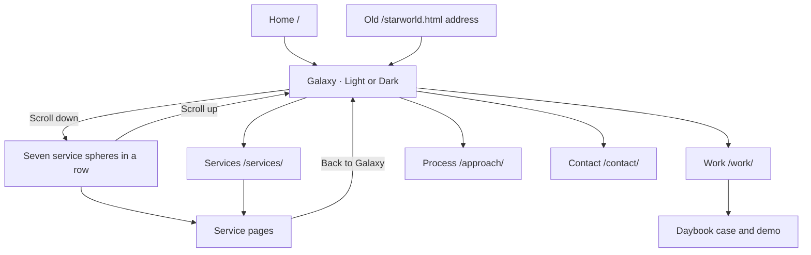
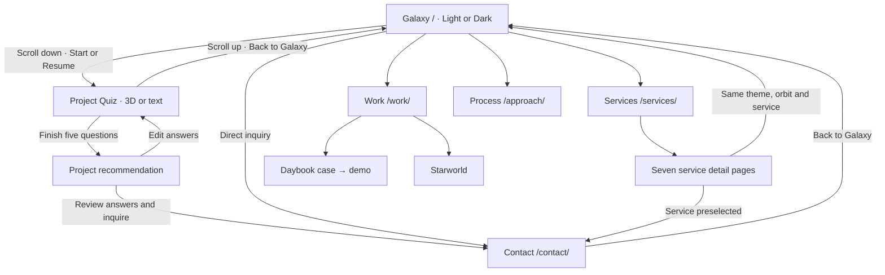

# LEVNAT design and navigation audit

November 13, 2026. Criteria from the [website design reference](../research/website-design-research.md) and [website mapping reference](../research/website-mapping-research.md).

## Current navigation

Galaxy opens in the device theme. Work retains Daybook, and the old Starworld address opens Galaxy. The audit below records the earlier design and quiz proposal.

## Evidence

Three audits covered mobile visuals and navigation, bidirectional quiz input, and desktop journeys. Checks ran on the local HTTP preview in Chromium with software WebGL. Touch was emulated at 320 × 568 and 390 × 844. Desktop journeys ran at 1140 × 900 and 1366 × 768. Cases included both palettes, Atom and Planets, keyboard focus, reduced motion, forced WebGL failure and an entry-module failure. One header check doubled computed font sizes to reproduce text enlargement; full zoom and assistive-technology checks remain open. Real phone performance, visitor task success, and secure inquiry submission remain to be measured.

`npm test` passed. Five focused browser regressions passed across two runs. The Atom wheel test timed out waiting for an in-flight frame in the combined run and passed in isolation. The existing reversal tests use Exit 3D for the return. Separate wheel and touch probes exercised upward scrolling explicitly.

An axe scan of the light quiz, dark overview, mobile Contact and desktop Hardware reported no violations in the selected rules. It returned contrast and ARIA items for manual review on Galaxy. The keyboard and enlarged-text checks below required manual or targeted assertions.

## What works

- The mobile first screen has a visible theme control, Services and a quiz entry. Tapping Services exposes all seven labeled destinations at 320 and 390 px. At 1366 × 768, all seven cards fit on the first desktop screen. The service catalog stays usable when WebGL is unavailable. [Galaxy markup](../../website/src/galaxy/index.html)
- Hardware and Automation pages put a specific heading, inquiry action and Back to Galaxy in the first viewport. Their inquiry links preselect the expected category. Back to Galaxy restores light theme, Planets and the originating service. A direct Hardware link also provides a return with Hardware selected. [Studio page definitions](../../website/src/studio/pages.js) · [Contextual navigation](../../tooling/scripts/build-studio.mjs)
- Exit 3D and Escape reverse the transition, restore the prior selected service and orbit mode, and return keyboard focus to the quiz launcher. The next entry resumes the next unanswered question. The native Back to Galaxy link in the homepage Contact section works at both mobile widths. [Quiz lifecycle](../../website/src/galaxy/js/ui.js)
- Work → Daybook case → demo retained the light Galaxy context. Starworld’s hosted header returned to the prior light Galaxy view during the audit. [Studio navigation](../../tooling/scripts/build-studio.mjs)

## Priorities and changes

| Priority                    | Observed                                                                                                                                                                                                                                                                 | Proposed change                                                                                                                                                                                                                                                                                                                                                                                                                       |
| --------------------------- | ------------------------------------------------------------------------------------------------------------------------------------------------------------------------------------------------------------------------------------------------------------------------ | ------------------------------------------------------------------------------------------------------------------------------------------------------------------------------------------------------------------------------------------------------------------------------------------------------------------------------------------------------------------------------------------------------------------------------------- |
| 1. Bidirectional transition | Scrolling down over the scene enters the quiz on mouse wheel and touch. Scrolling up from inside the quiz moves the document or stays at the top and leaves the quiz open. The first mobile sphere tap opens its hologram, and a second tap commits the answer.          | Give Galaxy and Quiz adjacent, labeled positions in the vertical flow. Let crossing the boundary forward form the quiz and crossing it backward assemble Core and restore the orbit view. Keep normal scrolling available around the scene. Provide visible Start or Resume Quiz and Back to Galaxy actions, and keep Previous question for moving between questions. [Current input handlers](../../website/src/galaxy/js/galaxy.js) |
| 1. Home and navigation      | At `/`, a dark device preference opens Starworld and a light preference opens Galaxy. The Dark Galaxy logo opens Light Galaxy, while the Light logo moves to its own top. Work and Process are direct Studio menu destinations but are absent from the dark Galaxy menu. | Make Galaxy the homepage in both themes. Give Galaxy and Studio a shared set of main navigation destinations. Keep the logo returning to Galaxy in the current palette and place Starworld under Work. Retain old Galaxy and Daybook links with their valid query and fragment context. [Startup routing](../../website/src/studio/start-route.js) · [Light page generator](../../tooling/scripts/build-galaxy.mjs)                   |
| 1. Preserve work            | Switching Light → Dark after one quiz answer kept Planets and Hardware but reduced the answer count from one to zero. The recommendation’s Planning link preselected Planning and left the inquiry description empty.                                                    | Apply theme changes in place where practical. Persist answers for the current tab across the journey and let the user review and edit the handoff on Contact. Keep personal details out of URLs. Test theme switch, back/forward, and re-entry after one or more answers. [Recommendation link](../../website/pages/explore.html) · [Studio form handler](../../website/src/studio/app.js)                                            |
| 2. Mobile Contact           | At 320 × 568 the standalone form starts around y855. At 390 × 844 it starts around y751, with the email field below the viewport at both widths. The sticky Let’s talk link reloads Contact and resets a preselected Planning category.                                  | Put the form immediately after a short heading or make the current-page action jump to the form. Keep typed text and the selected service during same-page navigation and error recovery.                                                                                                                                                                                                                                             |
| 2. Mobile quiz labels       | At 320 px the seven answer buttons occupy 1,120 px in a 272 px strip. One button fits completely at the starting position, and part of the next is visible. The final option works after horizontal scrolling.                                                           | Expose a clear All answers control leading to a vertical list. Keep the scene for exploration and clarify when a tap inspects a sphere versus selecting an answer.                                                                                                                                                                                                                                                                    |
| 2. Header and fallback      | At 320 and 390 px, doubling header text size overlapped the brand and theme switch without creating page overflow. Escape closed the menu without restoring focus to Menu. Blocking the Galaxy entry module left visible Menu and 3D Quiz actions inert.                 | Allow a two-row header when text needs room, restore focus on Escape, and give navigation and the text quiz an independent path that survives a scene-module failure.                                                                                                                                                                                                                                                                 |
| 3. Desktop composition      | On the 1366 × 768 light overview the scene is centered and its visible orbit field spans about 380 px. The title and quiz action sit far apart across the stage. At the same size the Daybook case’s launch button is below the first screen.                            | Group the purpose, actions and related details closer to the scene. Give the Daybook case an early Open demo link. Verify both changes in a normal laptop window as well as at wide widths.                                                                                                                                                                                                                                           |

## Original site proposal

Main menu order: Galaxy, Services, Work, Process, Contact. The header and page-return links serve visitors who skip the vertical flow. The same seven service names appear in the HTML list and on their detail pages. Work, the Daybook case and demo, Process, and Starworld all retain a visible Galaxy return. For visitors arriving directly, Galaxy opens with a sensible default and focuses the relevant service when known.

### Scroll and return contract

1. Galaxy appears above Quiz. A downward document scroll moves toward the labeled quiz boundary. On touch this means the finger moves up. Reaching the boundary activates the scene transition once. Reading Services, Contact or long text remains ordinary scrolling.
2. An upward document scroll across the same boundary returns to Galaxy. On touch the finger moves down. Core reassembles and the spheres resume their previous orbit layout and focus. Use the same return state for Back to Galaxy and Escape where applicable.
3. Scrolling leaves quiz answers and progress intact. Previous question reviews an answer within the quiz. Back to Galaxy leaves the quiz. Review answers on the result and inquiry routes.
4. Use stable sections and visible controls first. Add reversible animation as feedback. With reduced motion use an immediate state change. With unavailable 3D use the text path. Honor browser Back for actual page visits and avoid adding history entries for ordinary scrolling.

A 2026 study compared native and overridden scrolling in two desktop prototypes with 20 participants. Thirteen preferred native scrolling. For Galaxy, this supports testing a boundary-triggered animation that leaves normal reading and navigation under visitor control. Measure the effect separately on phones. WCAG requires an alternative for applicable path-based gestures. GOV.UK’s back-link guidance recommends returning to the prior page in the state last seen. [Voinea and Murano, February 2026](https://link.springer.com/chapter/10.1007/978-3-032-16454-4_6) · [W3C pointer gestures](https://www.w3.org/WAI/WCAG22/Understanding/pointer-gestures.html) · [GOV.UK back link](https://design-system.service.gov.uk/components/back-link/)

### Acceptance checks for a future implementation

| Likely failure                                                            | Estimated probability and impact | Detection and prevention                                                                                                                                                                         |
| ------------------------------------------------------------------------- | -------------------------------- | ------------------------------------------------------------------------------------------------------------------------------------------------------------------------------------------------ |
| Inertial scroll starts a second transition or traps reading               | High probability, high impact    | Test wheel, trackpad and touch across the boundary in both directions, including repeated input. Use a stable threshold, one transition per crossing and ordinary scroll outside the transition. |
| Reversal or theme changes discard answers or return to a different sphere | High probability, high impact    | Start in both orbit modes, answer one question, go up, switch theme, reopen and compare state. Restore overview focus and quiz progress from their respective state.                             |
| A visitor cannot navigate if motion or 3D is unavailable                  | Medium probability, high impact  | Test reduced motion, keyboard, enlarged text and entry-module failure. Keep independent HTML actions, visible focus and the text questionnaire.                                                  |
| A legacy URL or deep service visit no longer has a useful return          | Medium probability, high impact  | Check existing light, dark and Daybook links with query and fragment context. Verify both contextual return and browser history from direct service entry.                                       |

These checks specify the proposed behavior. The deliverable is the audit and navigation design.
