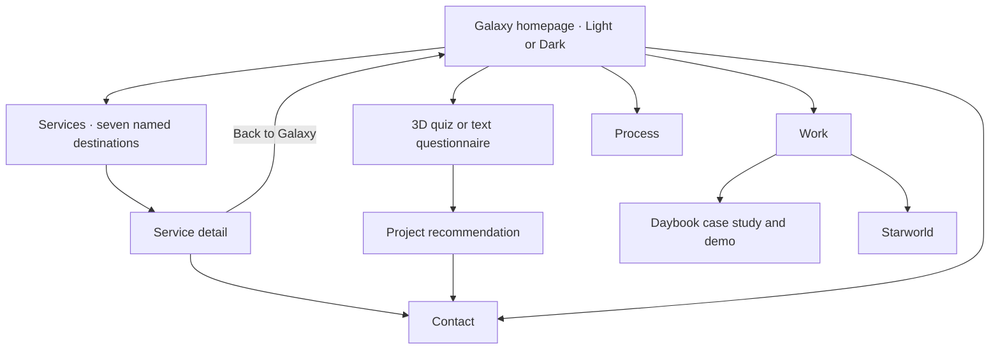

# Website mapping and navigation research

Selected primary studies and first-party evidence from 2024–2026, with foundational work and current standards. Sources checked November 13, 2026.

## What a website map describes

Information architecture covers how people find content through its grouping, labels and connections. Three views answer different questions about the same site.

| View            | What to record                                                                                            | Question it answers                                                         |
| --------------- | --------------------------------------------------------------------------------------------------------- | --------------------------------------------------------------------------- |
| URL inventory   | Address, purpose, preferred URL, redirects, and incoming and outgoing links                               | Which pages exist and how can someone reach them?                           |
| Navigation tree | Menu labels and groups expressed in visitors’ language                                                    | Where would someone look for a particular page?                             |
| Journey map     | Entry point, action, destination, next step and return path, including page sections and interface states | How can someone complete a task from the homepage, search or a direct link? |

The public navigation tree describes what visitors can browse. The XML sitemap lists preferred addresses for search engines. A public task can cross several routes, and a task such as the 3D quiz can also stay within one page. [Google Search Central, Build and submit a sitemap](https://developers.google.com/search/docs/crawling-indexing/sitemaps/build-sitemap)

## Information architecture principles

Dan Brown’s eight principles are a design framework. The following translations into site decisions are examples for LEVNAT. [Dan Brown, Eight principles of information architecture, 2010](https://doi.org/10.1002/bult.2010.1720360609)

| Principle               | Application                                                                                                 |
| ----------------------- | ----------------------------------------------------------------------------------------------------------- |
| Objects                 | Give each service a stable identity that connects its model, label and detail page.                         |
| Choices                 | Put actions that fit the current task together. On a service page, show how to inquire and how to return.   |
| Disclosure              | Show a short service description at selection and give scope, examples and pricing room on the detail page. |
| Exemplars               | Explain broad labels with concrete examples, such as failed webhooks under Backend / API.                   |
| Front doors             | Make each service page intelligible to a visitor who arrives directly from search.                          |
| Multiple classification | Let people browse by named service or start from a problem through the project questions.                   |
| Focused navigation      | Keep site destinations in the main menu and scene controls beside the scene.                                |
| Growth                  | Maintain a shared service catalog so additions have a consistent place in the map and navigation.           |

Measure whether visitors finish the task and recover from a wrong branch. Use click count to investigate friction. In one early study of 44 users and 620 task attempts, the data offered no support for a universal three-click limit. [Joshua Porter, Testing the Three-Click Rule, 2003](https://articles.centercentre.com/three_click_rule/)

## Research findings

**Make the first route to key content easy to see on mobile.** Baymard’s October 2026 benchmark covered more than 180 major US and European retailers and more than 17,000 manually scored homepage and navigation elements. Its rubric rated navigation mediocre or poor on 65% of mobile sites and 61% of desktop sites. In usability sessions, some shoppers struggled to start browsing when product categories sat behind a generic menu item. On a service site, this supports testing direct access to priority destinations. The percentages are retail design scores and provide no service-site task-completion benchmark. [Baymard Institute, published August 6, 2024, updated October 13, 2026](https://baymard.com/research-articles/ecommerce-navigation-best-practice)

**Give visitors words to scan for.** In a GOV.UK A/B test, visitors spent less time on text-heavy topic pages with a list and clicked through slightly more often than visitors shown a grid. In separate usability sessions, people scanned for terms related to their task and preferred short lists of three to six links across devices. The report supports testing a short, descriptive route to priority content. Its observations apply to GOV.UK topic pages, and the effect on another site needs its own comparison. [Government Digital Service, January 31, 2025](https://insidegovuk.blog.gov.uk/2025/01/31/rolling-out-simpler-ways-to-navigate-gov-uks-topic-pages/)

**Group content around how visitors use it.** University of Guadalajara researchers combined access logs, navigation tasks with 24 students, a terminology questionnaire with 58, and a closed sort of 30 cards with 20. Participants tended to group resources by their everyday function. The authors used that evidence to propose simpler labels and navigation groups. All participants were students from one academic unit. The study did not measure the proposed redesign after implementation. [Anaya-Chora, Cisneros-Hernández and Ramírez-Mercado, October 21, 2026](https://doi.org/10.3389/fcomp.2026.1847791)

**Tree test results depend on how the tree works.** Kuric and colleagues compared three tree-test interfaces with three high-fidelity menu prototypes using the same information architecture. They analyzed 1,800 task completions from 180 participants. Results varied across test interfaces. A cascading menu and its closest tree-test counterpart produced consistent interactions. Use a tree test to diagnose labels and hierarchy, then verify findability in the actual interface. [Kuric, Demcak and Krajcovic, July 2025](https://doi.org/10.1016/j.infsof.2025.107740)

**Treat first-click times from screenshots and live interfaces separately.** Across eight tasks, MeasuringU reported an average of task medians of 8.5 seconds to first click on live pages and 12.5 seconds on screenshots. The values describe the tested pages and conditions. For an interactive scene, measure the timing of the first real action on the device. [Sauro, Schiavone, Short and Lewis, July 23, 2024](https://measuringu.com/first-click-times-on-websites-versus-images/)

**Watch how visitors recover when navigation fails.** In the website portion of a 2026 hospital wayfinding study, four testers with severe visual impairments tried ten tasks. When they could not find information through the main paths, they turned to the footer sitemap, external search or maps. The hospital website and small qualitative sample limit generalization. For Galaxy, this motivates a direct check of how people find the HTML service links when a sphere is hard to locate or activate. [JMIR Human Factors, November 9, 2026](https://humanfactors.jmir.org/2026/1/e106882)

## How to test the structure

1. **Define tasks and acceptable outcomes.** Use visitors’ words, such as “I need someone to diagnose why a device stops reporting.” Decide which destinations satisfy the task before running the study. Keep tasks and starting conditions consistent when comparing versions. Record whether a participant starts on the homepage or a deep page.
2. **Use card sorting to investigate groups and vocabulary.** In an open sort, participants group content and name the groups themselves. In a closed sort, they assign content to candidate groups. Record disputed placements and recurring vocabulary. In a 2024 conference study, 112 participants grouped and labeled 50 Moodle content items. Their groupings informed a proposed structure. [Paea, Katsanos, Sharma and Bulivou, IEEE EDUCON, May 2024](https://doi.org/10.1109/EDUCON60312.2024.10578871)
3. **Use a text tree to test labels and hierarchy.** Give participants a task and let them browse an expandable tree. Record the first branch, chosen destination, task success, successful routes without backtracking and common wrong branches. Keep the tree interaction consistent across variants. [Experimental designs and open data from Kuric and colleagues](https://github.com/treetest-research/information-architecture-validation)
4. **Use a first-click or first-tap test to study the starting screen.** Record the entry screen and where the first action landed. Track first-choice accuracy and eventual task completion separately. A screenshot can show whether static links are noticeable. Use an interactive prototype or the live site for collapsed menus, gestures, 3D or content that changes in response to an action. [MeasuringU’s comparison of first clicks on live sites and screenshots](https://measuringu.com/do-click-tests-predict-live-site-clicks/)
5. **Observe the complete journey on phones.** Test with touch and real loading, from both the homepage and a direct link. Observe the next step and whether users can return to their previous context. Report successful attempts and total attempts per task and device type. Use a small qualitative round to identify recurring obstacles. A population-level success estimate requires a study designed for that purpose.

## Accessibility and discoverable URLs

| Area                     | What to verify                                                                                                                                                                                                                                                                                                                                                                                                                                                                                                                                                                                                                        |
| ------------------------ | ------------------------------------------------------------------------------------------------------------------------------------------------------------------------------------------------------------------------------------------------------------------------------------------------------------------------------------------------------------------------------------------------------------------------------------------------------------------------------------------------------------------------------------------------------------------------------------------------------------------------------------- |
| Consistent navigation    | WCAG 2.2 AA criterion 3.2.3 calls for repeated navigation to stay in the same relative order across the relevant pages, with an exception for user-initiated changes. Test the shared menu in both themes and on deep pages. [W3C, 3.2.3](https://www.w3.org/TR/WCAG22/#consistent-navigation)                                                                                                                                                                                                                                                                                                                                        |
| Alternative paths        | Criterion 2.4.5 calls for multiple ways to locate pages in a set, with an exception for process steps or results. For Galaxy, the native service links provide a second route alongside the 3D scene. Check that the links and quiz controls remain keyboard-operable and that the sticky header or hologram does not fully hide focused controls. [W3C, 2.4.5](https://www.w3.org/TR/WCAG22/#multiple-ways) · [W3C, 2.1.1](https://www.w3.org/TR/WCAG22/#keyboard) · [W3C, 2.4.11](https://www.w3.org/TR/WCAG22/#focus-not-obscured-minimum)                                                                                         |
| Touch and gestures       | WCAG 2.2 AA criterion 2.5.8 specifies 24 × 24 CSS px subject to its exceptions. Use 44 × 44 CSS px as a project design target for primary touch controls. Check the visible Quiz and Exit actions as alternatives to relying on swipes. For drag interactions, review criterion 2.5.7 and its exceptions. [W3C, 2.5.8](https://www.w3.org/TR/WCAG22/#target-size-minimum) · [W3C, 2.5.7](https://www.w3.org/TR/WCAG22/#dragging-movements)                                                                                                                                                                                            |
| Crawlable links          | Expose real destinations through HTML anchors with `href` and descriptive text. The animation may enhance an existing link. Verify that seven service destinations remain available with WebGL off. [Google Search Central, Link best practices](https://developers.google.com/search/docs/crawling-indexing/links-crawlable)                                                                                                                                                                                                                                                                                                         |
| Canonical URLs and moves | Align the preferred URL across canonical metadata, ordinary internal links and the XML sitemap. Use permanent server redirects for permanent URL moves where supported, while preserving bookmarked destinations that carry meaningful state. A sitemap helps discovery and does not guarantee indexing. [Google Search Central, Canonical methods](https://developers.google.com/search/docs/crawling-indexing/consolidate-duplicate-urls) · [Redirects](https://developers.google.com/search/docs/crawling-indexing/301-redirects) · [Sitemaps](https://developers.google.com/search/docs/crawling-indexing/sitemaps/build-sitemap) |

## Current LEVNAT map

This inventory comes from repository source. The navigation assessment below is a design hypothesis for testing with visitors.

| Entry or destination                                 | Current behavior                                                                                                                                                                                                                                                                                                                                                                                                                    |
| ---------------------------------------------------- | ----------------------------------------------------------------------------------------------------------------------------------------------------------------------------------------------------------------------------------------------------------------------------------------------------------------------------------------------------------------------------------------------------------------------------------- |
| `/`                                                  | The startup page opens light Galaxy on a light device theme and Starworld on a dark device theme. Older Daybook share links go to the demo. [Startup router](../src/studio/start-route.js)                                                                                                                                                                                                                                          |
| `/home/` and `/explore.html`                         | Light and Dark Galaxy share one scene and content. Planets and Atom are scene modes. The 3D quiz and the text questionnaire use the same answers and recommendation. Pricing, Process and Contact in the Galaxy menu are same-page sections. [Galaxy markup](../explore.html) · [Light-page generator](../scripts/build-galaxy-home.mjs) · [Quiz controls](../src/galaxy/js/ui.js)                                                  |
| `/services/`                                         | The standalone overview lists broad offers. Its Integration and Support pages overlap in subject with several specialist pages. The Galaxy menu’s Services link scrolls to seven service links on the same page. [Studio page definitions](../src/studio/pages.js) · [Galaxy service links](../explore.html)                                                                                                                        |
| Seven service detail pages                           | Websites and Apps, Backend and API, Automation, Post-Quantum Security, Data and Logs, Hardware, and Monitoring have separate URLs. The scene and the HTML service list lead to the same destinations. Service detail pages link to an inquiry with a preselected category and back to Galaxy with service and orbit context. [Service catalog](../src/shared/service-catalog.js) · [Return-link rules](../scripts/build-studio.mjs) |
| `/work/`, `/work/daybook/` and `/work/daybook/demo/` | Portfolio, Daybook case study and interactive demo. Work and the demo have direct links in the light Galaxy footer. [Studio page definitions](../src/studio/pages.js) · [Light-page generator](../scripts/build-galaxy-home.mjs)                                                                                                                                                                                                    |
| `/approach/`                                         | Delivery process and planning details. Galaxy also has an on-page Process section. [Studio page definitions](../src/studio/pages.js) · [Galaxy markup](../explore.html)                                                                                                                                                                                                                                                             |
| `/contact/` and `#contact`                           | Both collect inquiries. The Galaxy form includes selected quiz answers. The recommendation’s planning link opens the standalone Contact page and preselects Planning, with no automatic handoff of quiz answers along that path. [Galaxy form and recommendation](../explore.html) · [Galaxy form handler](../src/galaxy/js/ui.js) · [Studio form handler](../src/studio/app.js)                                                    |
| `/starworld.html`                                    | A separate service map with a project brief and a Galaxy return link on the hosted route. [Starworld navigation](../src/starworld/app.js)                                                                                                                                                                                                                                                                                           |

The XML sitemap lists light Galaxy and the Studio pages. Dark Galaxy points its canonical to the startup URL, while light Galaxy points to `/home/`. The two theme variants therefore signal different preferred addresses. The older page inventory also still puts the Daybook demo on Home. [XML sitemap](../sitemap.xml) · [Dark Galaxy](../explore.html) · [Light Galaxy](../home/index.html) · [Older page inventory](website-pages.md)

## Proposed structure for discussion

**Give the homepage one identity.** Use Galaxy at `/` with the device preference choosing the initial palette and the Light / Dark control overriding it. Keep Starworld available under Work as a separate 3D experience. Treat existing Galaxy and Daybook URLs as compatibility routes while deciding how to preserve links with query parameters and fragments.

**Use one service catalog with several entry points.** Put Galaxy, Services, Work, Process and Contact in a consistent main navigation. Make Services lead to the named service catalog and expose the same seven destinations in the scene. If Integration and Support stay as broader entry pages, link them to the relevant specialists and describe their distinct purpose. Confirm grouping with users before consolidating existing URLs.

**Match the route to the visitor’s intent.** A visitor who knows the service goes directly to details and then to an inquiry. A visitor who is unsure can take the five-question quiz or use its text version, then see an actionable recommendation. A visitor who wants to talk can open Contact immediately. Where an inquiry follows the quiz, show which answers will carry over and let the visitor edit them. Keep answers and personal details out of shared URLs.

**Keep orientation on every entry.** Give a direct visitor a clear page title, access to the relevant section and a visible route to Galaxy. When returning from a sphere’s service page, preserve theme, Atom or Planets, and the selected service. Test whether the return cue makes sense to someone who opened the service directly and has never seen the scene.

## Questions to test on LEVNAT

| Task in a visitor’s words                                                     | What to observe                                                                                                                                                                   |
| ----------------------------------------------------------------------------- | --------------------------------------------------------------------------------------------------------------------------------------------------------------------------------- |
| “We copy requests by hand between two tools. Who can help?”                   | Whether the visitor finds Automation, the broader Integrations route, or another plausible route and can explain the difference.                                                  |
| “A device stopped sending data. Find out who can investigate.”                | Whether the visitor distinguishes Hardware, Data / Logs and Monitoring. Check the first tap, destination and next action.                                                         |
| “I have an idea for an app and don’t know what to ask for.”                   | Whether the quiz and text questionnaire are discoverable, whether tapping a model advances the question, and whether the recommendation helps the visitor decide what to do next. |
| “Open Hardware from a shared link and get to the main site.”                  | Whether the page is understandable out of context, and whether Galaxy, Services and Contact can all be found.                                                                     |
| “Open a service from Galaxy, switch the theme when you return, and continue.” | Whether the visitor can return to the same sphere and orbit mode. Include switching with a partially answered quiz to detect loss of progress.                                    |
| “Finish the project questions and ask about a planning session.”              | Whether the visitor sees which details will be sent, can edit them and reaches the expected inquiry confirmation in a configured test environment.                                |

For each task, compare first-choice accuracy, task success, successful direct paths, time and backtracks. Record alternative successful routes and recurring wrong turns. Use the text tree to diagnose categories and labels, and use the mobile interface to evaluate gestures, progress and return. Include the regular interface, keyboard use and WebGL fallback in implementation checks. This review did not measure those outcomes with LEVNAT visitors.
